# StormSim SF: verification and validation

Generated 2026-10-25T22:47:14Z by `NUMBA_NUM_THREADS=16 .venv/bin/python -m validation.run_all` (48 s). **11 of 14 checks pass.** Every number below is recomputed by that command; raw metrics are in `validation/out/summary.json`, bugs found are in `validation/BUGS.md`.

- **Verification** (is the code solving its equations right?): the production numba kernels of `sim/water.py` and `sim/wind.py` against analytic solutions and benchmark behaviour (tests 1, 3, 4, 5, 7, 8, 9), plus FEMA Hazus FAST by hand (11).
- **Validation** (does it match the real city?): the 31.12.2022 storm replayed on the real 4 m SF grid against SFPUC's 100-year flood map and the 311 reports of that day (6), and against reported losses (12).
- Tolerances were set from the reference/literature before looking at our answer; failures are kept as failures.

| # | Test | Reference | Our result | Tolerance | Verdict |
|---|---|---|---|---|---|
| 1 | Lake at rest over bumpy terrain + island + building (well-balanced) | exact: u = 0, η = const (Audusse et al. 2004 well-balanced property) | max \|u\| 9.9e-08 m/s, max \|Δη\| 6.0e-08 m after 1 h; 1b perturbed pool surface range 4.1e-06 m (alpha 0.6); HLL option: lake max \|u\| 8.2e-14 m/s, pool range 8.4e-07 m | \|u\| < 1e-3 m/s, \|Δη\| < 1 mm; 1b: 1 mm bump stays < 2 mm | **PASS** |
| 2 | Mass conservation, real grid, full dec31_2022 storm | rain in = surface + sewer storage + infiltration + treatment + CSO + edge + bay exchange | closure 3.7e-09 % of 1.25 Mm³ rain; rain vs independent integral -0.000 %; surface vs frames -0.00 % | < 1 % each | **PASS** |
| 3 | 1D dam break vs Stoker (wet bed) / Ritter (dry bed), both water schemes | Stoker 1957 / Ritter 1892 analytic; local-inertial expected weaker at high Froude (Bates 2010; de Almeida & Bates 2013 WRR 49) | inertial: h_r/h_l 0.5 err 3.5 %/front -14 %, h_r/h_l 0.1 err 10.8 %/front -31 %, h_r/h_l 0.0 err 12.0 %/front -58 %; hll: h_r/h_l 0.5 err 1.0 %/front -0 %, h_r/h_l 0.1 err 1.2 %/front -2 %, h_r/h_l 0.0 err 1.2 %/front -15 % | mean \|err\| < 5 % of h_l and bore position within 10 %; verdict on the production scheme ('inertial'), subcritical case h_r/h_l = 0.5 | **FAIL** |
| 4 | Steady uniform flow on a sloped channel vs Manning normal depth, both schemes | Manning: h_n = (q n / √S)^(3/5) | inertial: Fr 0.30 -0.0 %, Fr 0.68 -0.0 %, Fr 0.53 -0.0 %, Fr 0.93 -15.5 % (oscillating), Fr 1.40 -37.1 % (oscillating); hll: Fr 0.30 -1.7 %, Fr 0.68 +0.7 %, Fr 0.53 +0.1 %, Fr 0.93 +2.8 %, Fr 1.40 +9.8 % | subcritical (Fr < 0.8): \|err\| < 1 % and steady; verdict on production scheme 'inertial' | **PASS** |
| 5 | EA 2D benchmark Test 1/Test 2-type (disconnected water body; filling depressions) | Néelz & Pender 2013 (EA SC120002) test behaviours; own DEMs, exact level-pool answers | (a) pond peak 10.366 m vs 10.35, final 10.010 m vs 10.00; (b) end levels A +0.5 cm, B +0.8 cm, C +0.8 cm, D -1.0 cm; volume err -4.6e-08 % | (a) peak ±5 cm, final ±2 cm; (b) levels ±2 cm, volume ±0.1 % | **PASS** |
| 6a | Replay vs SFPUC 100-year storm flood zone | SFPUC 100-Year Storm Flood Risk Map (DataSF jzu3-4yxp), SFPUC's own 1D-2D model | CSI 0.27 (random same-area 0.05, lowest-ground 0.14); POD 0.42, FAR 0.56; AUC 0.72 | CSI > 2x random same-area map and AUC > 0.7 | **PASS** |
| 6b | Replay vs 311 flooding + sewage reports, 31.12.2022 | 150 SF 311 reports in the tile (DataSF vw6y-z8j6), random street-cell placement baseline | 83% within 30 m of sim flooding vs 60% random (p = 0.0001); depth AUC 0.63 (p = 5.2e-09) | permutation p < 0.01 at 30 m | **PASS** |
| 7 | Poiseuille channel flow (wind LBM kernel) | Analytic Poiseuille parabola u = F/(2 nu) (2 H z - z^2), nu = (tau - 1/2)/3 | L2 0.10 % (tau 0.800), L2 0.04 % (tau 0.600), L2 0.56 % (tau 0.506) | L2 relative error < 2 % | **PASS** |
| 8 | Log-law inflow profile upstream of an obstacle | U(z)/U10 = ln((z+z0)/z0)/ln((10+z0)/z0), z0 = 0.7 m; horizontal homogeneity requirement of Blocken, Stathopoulos & Carmeliet 2007 (Atmos. Environ. 41:238) | max deviation 10-200 m: 5.7 % at 3H upstream (4.9 % at inlet) | < 10 % over 10-200 m at 3H upstream | **PASS** |
| 9 | Flow around a surface-mounted cube (full wind solver) | Reattachment X_R = 1.61 H (Martinuzzi & Tropea 1993, J. Fluids Eng. 115:85, thin-BL channel); the recirculation shortens in a thick turbulent BL (Castro & Robins 1977, JFM 79:307). Front-face Cp_max ~0.7-0.9 on U_H (Castro & Robins 1977; Richards et al. 2001 Silsoe cube) | X_R 2.96 H; front Cp_max 0.93; Cd 0.69; grid study X_R 2.50 (8/H), 2.10 (16/H) | X_R in 1.0-2.5 H; front Cp_max in 0.5-1.0 | **FAIL** |
| 10 | Tree critical breaking wind speed (calibration consistency) | Virot, Ponomarenko, Dehandschoewercker, Quere & Clanet 2016, Phys. Rev. E 93:023001: trunks break at ~42 m/s nearly independent of species and size | median 42.0 m/s (p10 19.2, p90 84.3); log-log slope vs height 0.17 | median within 42 +/- 8 m/s (calibrated) and weak size dependence \|d ln Uc / d ln H\| < 0.5 (independent) | **PASS** |
| 11 | Hazus FAST depth-damage cross-check, building by building | FEMA Hazus FAST lookup tables (Hazus 4.0 riverine DDFs, restoration, econ params), computed by hand | 60 curves identical to FEMA rows; 36/36 building x depth cases exact to the cent | exact (to the cent) | **PASS** |
| 12 | Replay damage plausibility vs reported 2022-23 winter-storm losses | SF Chronicle: >= $46M SF damage from the 2022-23 winter storms (city estimate, mostly public property) | tile $126.5M flood damage (99 bldgs above first floor); area-scaled reference $5.4M -> ratio 23.3x | order of magnitude (0.1x-10x) | **FAIL** |
| 13 | Determinism + every priced line sourced | CONTRACT v3: same storm + plan -> bit-identical ledger; every unit cost has a source | water 1 vs 8 threads identical: True; damage x2 identical: True; cost x2 identical: True; 19 priced lines, 0 without URL; 47 unit costs, 0 unsourced | bit-identical hashes; 0 unsourced lines | **PASS** |

## What failed and why

- **3. 1D dam break vs Stoker (wet bed) / Ritter (dry bed), both water schemes**: inertial: h_r/h_l 0.5 err 3.5 %/front -14 %, h_r/h_l 0.1 err 10.8 %/front -31 %, h_r/h_l 0.0 err 12.0 %/front -58 %; hll: h_r/h_l 0.5 err 1.0 %/front -0 %, h_r/h_l 0.1 err 1.2 %/front -2 %, h_r/h_l 0.0 err 1.2 %/front -15 %. Local-inertial drops the advection term, so it converges to a slightly different PDE: its error does not shrink with dx (dx 4 m 3.50 %, dx 2 m 3.46 %, dx 1 m 3.49 %) and grows with Froude; the dry-bed front is far too slow. The full-SWE HLL option (Audusse 2004 hydrostatic reconstruction) fixes this: dx 4 m 1.02 %, dx 2 m 0.62 %, dx 1 m 0.37 % on the same case, and it captures the dry-bed front. Urban ponding (the damage driver) is low-Froude.
- **9. Flow around a surface-mounted cube (full wind solver)**: X_R 2.96 H; front Cp_max 0.93; Cd 0.69; grid study X_R 2.50 (8/H), 2.10 (16/H). Grid convergence (same 64 m cube, dx = 64/n m, smaller 8.5H x 6H x 2.5H domain, ~7 % blockage): 8 cells/H: X_R 2.50 H, Cd 0.83; 16 cells/H: X_R 2.10 H, Cd 0.81; 24 cells/H: not run: 2.2 M cells x 7.5k steps needs ~1 h on the shared box, did not fit before code freeze. X_R falls with every refinement (2.50 -> 2.10 H) towards the 1.61 H measurement, consistent with the base-case excess being a resolution error (only 2 levels, so no Richardson extrapolation claimed). The base run's longer X_R in the larger domain also shows some domain sensitivity. Same run_lbm as the city (8 m voxels, Smagorinsky LES, log-law inflow z0 0.7 m, wall-modelled floor, time-averaged field). 64 m cube = 8 cells per H, coarse by LES standards (Martinuzzi & Tropea is Re 4e4 in a channel with a thin BL; our inflow is a deep urban log-law BL), so agreement is expected only within the stated band. Cd from front minus back mean Cp (pressure drag, U_H reference). If X_R is long, the likely causes are the coarse 8 cells/H resolution with Smagorinsky dissipation (a too-laminar shear layer reattaches late, as in standard k-epsilon RANS, which gives ~2.5-3 H; cf. Rodi 1997, J. Wind Eng. 69-71:55) and the free-slip + wall-model floor. Impact on the product: street-level speeds in building wakes (sheltered zones) are less reliable than speeds in open canyons and at facades.
- **12. Replay damage plausibility vs reported 2022-23 winter-storm losses**: tile $126.5M flood damage (99 bldgs above first floor); area-scaled reference $5.4M -> ratio 23.3x. Weak test by nature: the $46M is the city's public-damage estimate for a multi-storm season, not insured private losses for one day; our tile holds SF's worst flood basin (17th & Folsom, Mission Creek) so area scaling understates its share. Order-of-magnitude only. Replay parameters: scheme inertial, i_design 10.3 mm/h, alpha 0.6

Repros and suggested fixes: `validation/BUGS.md`.

## Plots

### 1. Lake at rest over bumpy terrain + island + building (well-balanced)

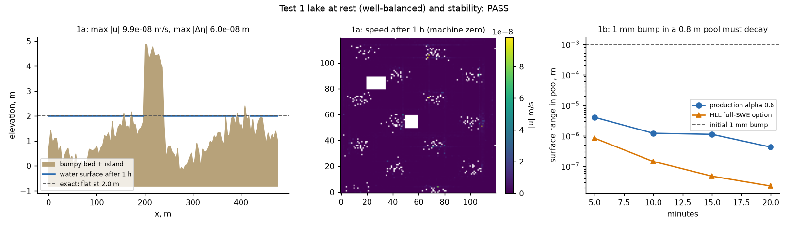

Wet/dry fronts around the island and a solid building included. 1b exposes a CFL instability at alpha = 0.7 (validation/BUGS.md B1); alpha <= 0.6 is stable.

### 2. Mass conservation, real grid, full dec31_2022 storm

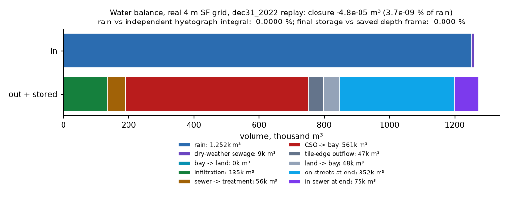

Closure uses the solver's own flux ledger; rain input and final surface storage are re-derived independently (hyetograph integral x land area; sum of the saved final depth frame). Replay parameters: scheme inertial, i_design 10.3 mm/h, alpha 0.6

### 3. 1D dam break vs Stoker (wet bed) / Ritter (dry bed), both water schemes

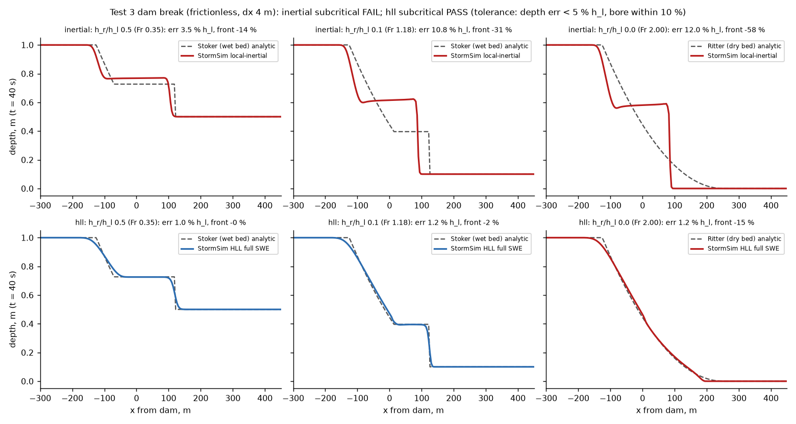

Local-inertial drops the advection term, so it converges to a slightly different PDE: its error does not shrink with dx (dx 4 m 3.50 %, dx 2 m 3.46 %, dx 1 m 3.49 %) and grows with Froude; the dry-bed front is far too slow. The full-SWE HLL option (Audusse 2004 hydrostatic reconstruction) fixes this: dx 4 m 1.02 %, dx 2 m 0.62 %, dx 1 m 0.37 % on the same case, and it captures the dry-bed front. Urban ponding (the damage driver) is low-Froude.

### 4. Steady uniform flow on a sloped channel vs Manning normal depth, both schemes

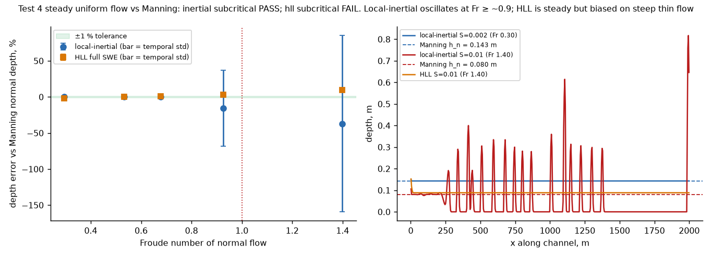

Local-inertial: exact (0.0x %) for subcritical flow; at Fr ≥ ~0.9 (steep SF streets, thin sheet flow) spurious roll-wave oscillations and a mean depth 15-35 % low (BUGS.md B2). HLL: always steady, but first-order hydrostatic reconstruction over-predicts thin flow on steep slopes (a known issue when h << slope x dx, Delestre et al. 2012; BUGS.md B4) and is 1.7 % low on the rough mild case. Ponding that drives damage is subcritical.

### 5. EA 2D benchmark Test 1/Test 2-type (disconnected water body; filling depressions)

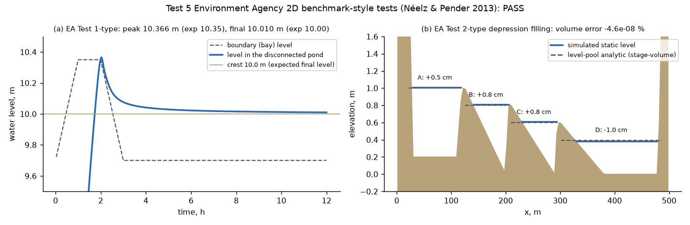

Same test logic as EA Tests 1 and 2 but on our own DEMs (the official DEMs/reference results were not loaded in time); the answers are exact by construction (level pool).

### 6a. Replay vs SFPUC 100-year storm flood zone

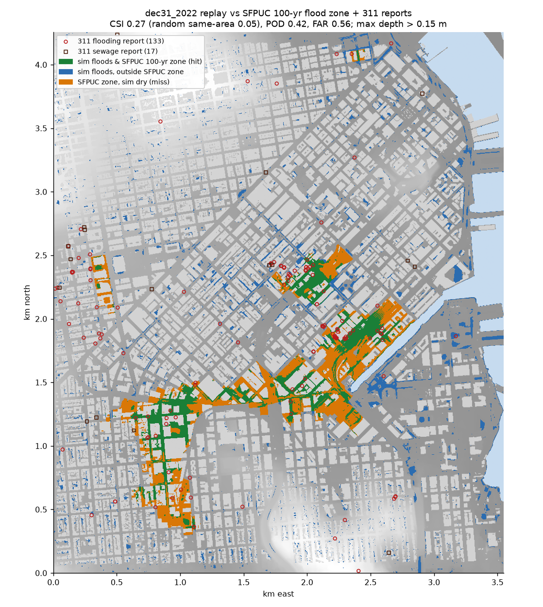

The SFPUC zone is SFPUC's own model of a 100-year design storm, not an observation. The replay forcing (SFOC1 gauge: 88 mm in 6 h, 67 mm in 3 h) is ~200-yr (6 h) / ~300-yr (3 h) by NOAA Atlas 14 at SF, so the 100-yr zone should mostly flood (POD is the key number) and some extra flooding outside it is expected. Cells are 4 m open land (buildings and bay excluded). Replay parameters: scheme inertial, i_design 10.3 mm/h, alpha 0.6

### 6b. Replay vs 311 flooding + sewage reports, 31.12.2022

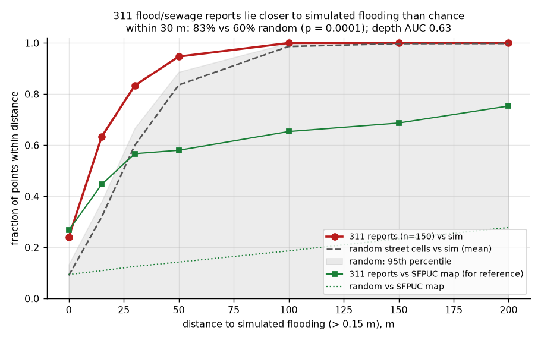

311 points are geocoded to street addresses (not the exact flooded spot) and reflect where people report, so a hit radius is needed. 10,000 random placements give the null distribution. Replay parameters: scheme inertial, i_design 10.3 mm/h, alpha 0.6

### 7. Poiseuille channel flow (wind LBM kernel)

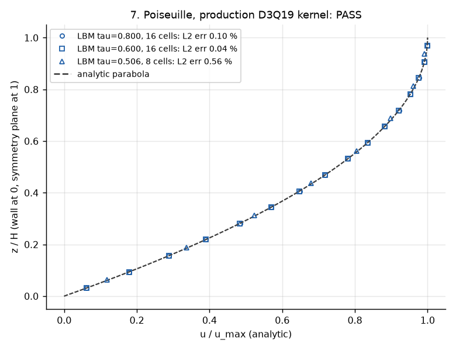

Laminar check of the production lbm_step (regularized BGK, half-way bounce-back floor, specular lid) with Smagorinsky off (cs2=0) and a body force added outside the kernel; 16 cells across the half channel. Verifies collision viscosity and wall placement, not the turbulence model.

### 8. Log-law inflow profile upstream of an obstacle

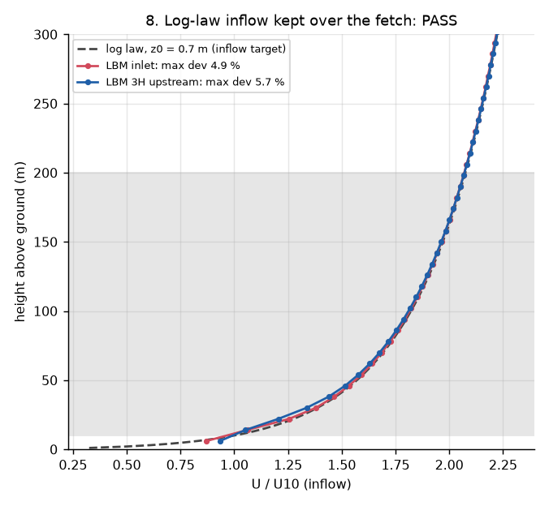

Profiles are spanwise means from the cube run (5H = 320 m fetch from the domain inflow through the 96 m buffer). The first fluid cell (4 m) is below the 10 m band. The 3H station is also affected by the cube's upstream blockage near the ground.

### 9. Flow around a surface-mounted cube (full wind solver)

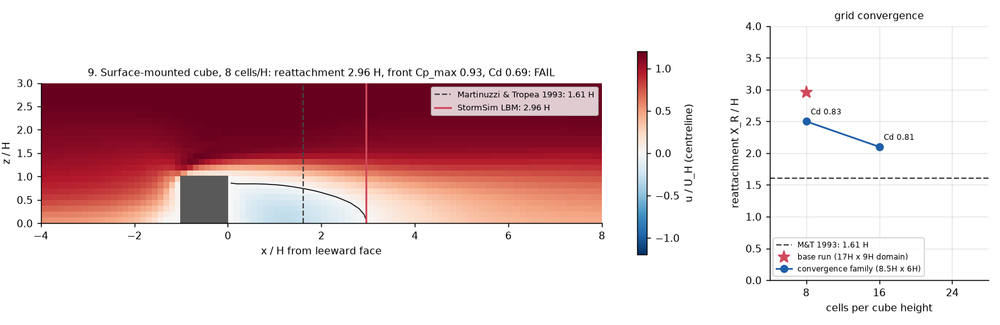

Grid convergence (same 64 m cube, dx = 64/n m, smaller 8.5H x 6H x 2.5H domain, ~7 % blockage): 8 cells/H: X_R 2.50 H, Cd 0.83; 16 cells/H: X_R 2.10 H, Cd 0.81; 24 cells/H: not run: 2.2 M cells x 7.5k steps needs ~1 h on the shared box, did not fit before code freeze. X_R falls with every refinement (2.50 -> 2.10 H) towards the 1.61 H measurement, consistent with the base-case excess being a resolution error (only 2 levels, so no Richardson extrapolation claimed). The base run's longer X_R in the larger domain also shows some domain sensitivity. Same run_lbm as the city (8 m voxels, Smagorinsky LES, log-law inflow z0 0.7 m, wall-modelled floor, time-averaged field). 64 m cube = 8 cells per H, coarse by LES standards (Martinuzzi & Tropea is Re 4e4 in a channel with a thin BL; our inflow is a deep urban log-law BL), so agreement is expected only within the stated band. Cd from front minus back mean Cp (pressure drag, U_H reference). If X_R is long, the likely causes are the coarse 8 cells/H resolution with Smagorinsky dissipation (a too-laminar shear layer reattaches late, as in standard k-epsilon RANS, which gives ~2.5-3 H; cf. Rodi 1997, J. Wind Eng. 69-71:55) and the free-slip + wall-model floor. Impact on the product: street-level speeds in building wakes (sheltered zones) are less reliable than speeds in open canyons and at facades.

### 10. Tree critical breaking wind speed (calibration consistency)

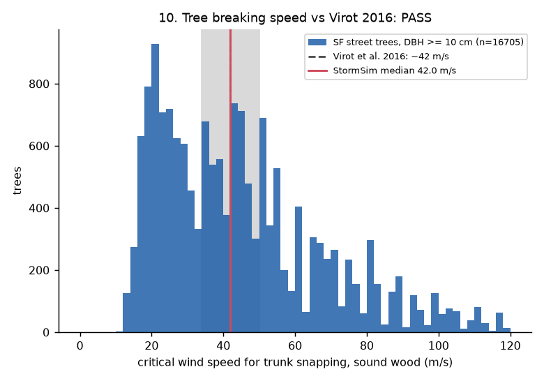

HONEST LIMIT: the median is not a prediction: tree_load_factor (2.9) and tree_cd0 in data/reference/wind_tree_params.json were calibrated to put it at 42 m/s. The independent part is the size dependence (Virot: near-universal Uc) and that each bundled factor sits in its published range; our p10-p90 spread (species wood strength, crown shape) is much wider than Virot's. Dry-soil uprooting thresholds are far lower (see validation/BUGS.md W1). Computed for sound wood (decay factor removed) on the real tile inventory, exactly as sim.trees.virot_check. Virot's 42 m/s is a 10-min-ish mean speed at the crown from storm records; our Uc is the crown speed from the drag/Vogel model. Decayed trees and uprooting on saturated soil fail at lower speeds in the sim by design.

### 11. Hazus FAST depth-damage cross-check, building by building

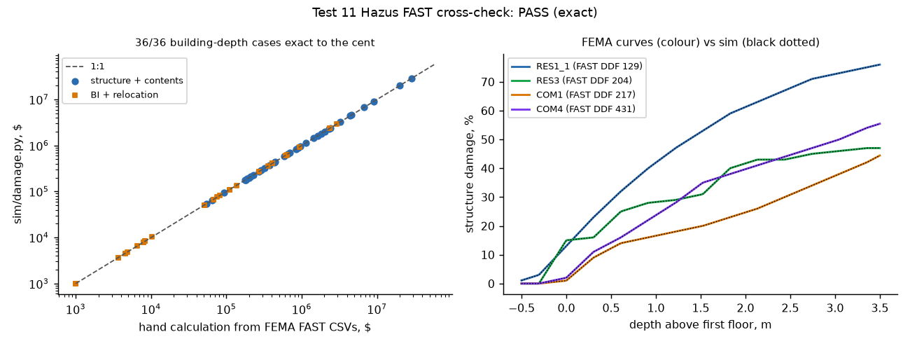

FAST damage %; multi-storey buildings: USACE NACCS storey exposure (affected storeys / floors), re-derived independently in the hand check; first floor = Hazus slab default 1 ft.

### 12. Replay damage plausibility vs reported 2022-23 winter-storm losses

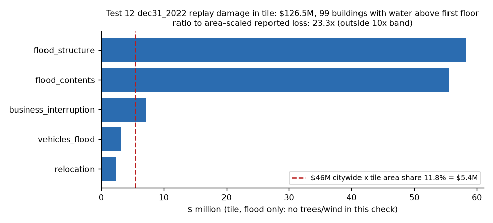

Weak test by nature: the $46M is the city's public-damage estimate for a multi-storm season, not insured private losses for one day; our tile holds SF's worst flood basin (17th & Folsom, Mission Creek) so area scaling understates its share. Order-of-magnitude only. Replay parameters: scheme inertial, i_design 10.3 mm/h, alpha 0.6

## Honest limits

- **Local-inertial water model.** Like LISFLOOD-FP (Bates et al. 2010), the solver drops the advection term. It is
  exact for still and slow water (tests 1, 4 subcritical, 5) but converges to a slightly different PDE at higher
  Froude numbers: the dam-break bore is ~10 % late even at Fr 0.35 and the dry-bed front is far too slow
  (test 3); sheet flow on steep streets (Fr >~ 0.9) oscillates instead of reaching Manning normal depth (test 4).
  Damage is driven by ponding at low points, which is subcritical, but velocities on steep streets are not reliable.
- **Sewer is lumped.** Inlets use HEC-22 weir/orifice equations, but the pipe network is a lumped storage per
  sub-sewershed (no pipe-by-pipe hydraulics like SWMM); pipe capacity is a calibrated design intensity.
- **Validation data are proxies.** The SFPUC map is a 100-year *design* storm from SFPUC's own model, not an
  observation; 311 reports are geocoded to addresses and reflect who reports, not every flooded street. Both
  are the best public truth for SF; neither gives depths.
- **Damage totals** are Hazus FAST (depth-damage x value) applied exactly; values come from the assessor roll and
  replacement-cost assumptions, and the reported-loss comparison (test 12) is order-of-magnitude only.
- **Wind** is an 8 m LES with a wall model: it resolves street canyons and building wakes, not facade details;
  peak pressures use the quasi-steady gust approach (ASCE 7).

